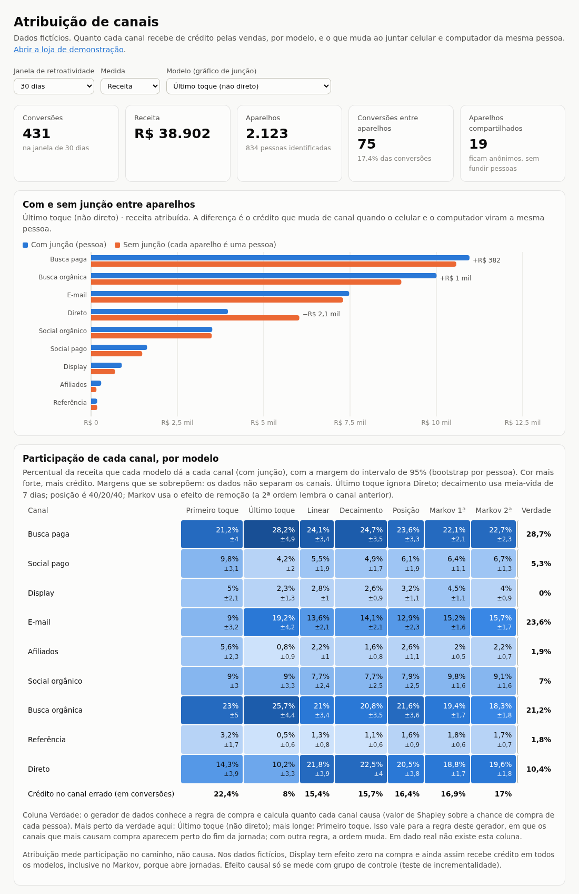

# Atribuição de canais

De onde vêm os clientes de um site e qual canal merece o crédito por cada
venda, inclusive quando a pessoa clica no anúncio pelo celular e compra no
computador, sem dado de terceiros e dentro da LGPD.

O projeto implementa por dentro o que GA4, RD Station, Mixpanel e afins
vendem prontos: coleta com consentimento por finalidade, classificação de
canais, junção de identidade entre aparelhos, sete modelos de atribuição com
margem de erro, funil e um teste de incrementalidade que mede o que os
modelos não medem: causa. Os dados são fictícios.



## Rodar

```bash
uv sync
uv run python scripts/gerar_dados.py      # 2.000 pessoas fictícias em atribuicao.db
uv run uvicorn app.main:app --reload
```

- Painel: <http://localhost:8000/>. Pede o token de administrador, que o
  servidor escreve no log ao subir quando `ATRIBUICAO_TOKEN_ADMIN` não está
  definido.
- Loja de demonstração: <http://localhost:8000/loja>. Abra no celular e no
  computador, aceite a junção, entre com o mesmo e-mail nos dois e compre em
  um deles.
- Testes: `uv run pytest` (91 testes; o CI roda os mesmos a cada push).
- Para o teste de incrementalidade ter poder estatístico, gere mais gente:
  `uv run python scripts/gerar_dados.py --pessoas 20000 --substituir`. A
  primeira carga do painel leva ~20 s nesse volume e depois sai do cache.

| Variável | Para quê | Padrão |
|---|---|---|
| `ATRIBUICAO_CHAVE_HMAC` | chave da pseudonimização do e-mail | chave de desenvolvimento, com aviso |
| `ATRIBUICAO_TOKEN_ADMIN` | token do painel e das rotas de manutenção | sorteado a cada subida e escrito no log |
| `ATRIBUICAO_BANCO` | caminho do SQLite | `atribuicao.db` |
| `ATRIBUICAO_ORIGENS` | sites que podem hospedar o rastreador (CORS) | só o mesmo domínio |
| `ATRIBUICAO_ATRAS_DE_PROXY` | `1` para ler o IP do `X-Forwarded-For` | desligado |
| `ATRIBUICAO_REPLICAS` | réplicas do bootstrap | 100 |
| `ATRIBUICAO_GERAR_DEMO` | `1` para gerar dados fictícios ao subir com o banco vazio | desligado |

Publicação: `render.yaml` descreve o serviço para o Render (Blueprint), com os
segredos sorteados pela própria plataforma.

## Como funciona

```
navegador                         servidor                          análise
─────────                         ────────                          ───────
banner: medição / junção ───────▶ registra cada finalidade
visita de entrada (UTM,           confere consentimento de novo,
  referrer, gclid) ─────────────▶ limita por IP, classifica ──▶ eventos ─┐
login, carrinho ────────────────▶ etapas do funil ─────────────▶ etapas ─┤
e-mail (só com junção) ─────────▶ HMAC do e-mail ──────────────▶ vínculos┼▶ jornadas por pessoa (30 dias)
                                                                         │   ├▶ 7 modelos + bootstrap
plataforma de anúncios ─────────▶ sorteio tratamento/controle ─▶ experim.┘   ├▶ funil por canal
                                                                             └▶ teste de incrementalidade
```

| Parte | Arquivo |
|---|---|
| Classificação de canais | `app/canais.py` |
| Junção entre aparelhos | `app/identidade.py` |
| Montagem das jornadas | `app/jornadas.py` |
| Modelos de atribuição | `app/atribuicao.py` |
| Margem de erro (bootstrap) | `app/incerteza.py` |
| Funil | `app/funis.py` |
| Teste de incrementalidade | `app/incrementalidade.py` |
| Comparação com a verdade do gerador | `app/verdade.py` |
| Pseudonimização, exclusão, retenção | `app/privacidade.py` |
| Acesso de administrador, limite por IP | `app/acesso.py`, `app/limite.py` |
| Esquema, datas em UTC, e-mail simulado | `app/banco.py`, `app/tempo.py`, `app/correio.py` |
| API | `app/main.py` |
| Rastreador, loja, política, painel | `web/` |
| Dados fictícios | `scripts/gerar_dados.py` |

## Decisões

**Canais.** A UTM ganha do referrer, porque é a única informação que o dono
do link controla. `gclid` conta como Busca paga; `fbclid` não conta como pago,
porque o Facebook o acrescenta também em compartilhamentos orgânicos.

**Junção entre aparelhos só por identificação própria.** Login ou formulário
ligam o aparelho ao pseudônimo da pessoa, e todos os eventos daquele
aparelho, inclusive os de antes do login, passam a ser dela. Um aparelho
ligado a duas pessoas (o notebook da família) fica ambíguo e não funde
ninguém.

**Modelos.** Primeiro toque, último toque não direto (convenção do GA4),
linear, decaimento temporal (meia-vida de 7 dias), posição 40/20/40 e Markov
com efeito de remoção, de 1ª e de 2ª ordem. A 2ª ordem lembra o canal
anterior, ao custo de estimar ~74 estados em vez de 9 com o mesmo volume de
dados. Um teste garante que todo modelo distribui exatamente as conversões e a
receita existentes.

**Margem de erro.** Cada participação vem com intervalo de 95% por bootstrap,
reamostrando pessoas (não jornadas, que não são independentes entre si).

**Privacidade.**
- Consentimento separado por finalidade (medição; junção entre aparelhos),
  com as caixas desmarcadas e uma política que descreve o que o código faz.

  

- HMAC-SHA256 com chave em vez de hash puro, porque e-mail tem pouca
  entropia.
- Minimização no esquema: e-mail e IP não são gravados, do referrer fica só
  o host, do navegador só a classe do aparelho.
- A exclusão a pedido exige um código enviado ao e-mail.
- A retenção padrão é de 13 meses, com piso de 30 dias para a rota não
  esvaziar o banco.

**Segurança.** O painel e a manutenção exigem token. As rotas públicas têm
limite por IP, e o IP fica só em memória. O CORS só libera as origens
listadas e não libera o cabeçalho `Authorization`.

## O que os dados fictícios mostram

Com a semente padrão (2.000 pessoas): 431 compras, das quais 84 começam num
aparelho e terminam em outro. A junção recupera 75 delas, as de quem também
fez login no celular. No último toque, a junção tira 18 compras de Direto e as
devolve a Busca paga, Busca orgânica e aos outros canais. É a venda que "veio
do nada" no computador e na verdade começou num anúncio no celular.

**Atribuição não é causa.** No gerador, Display tem efeito zero na chance de
compra. Mesmo assim, recebe 4,5% das compras no Markov e 5,3% no primeiro
toque, porque abre jornadas. O teste de incrementalidade, com 20.000 pessoas,
mede o que os modelos não medem:

| Canal | Efeito real (gerador) | Medido no teste (IC 95%) | Crédito dado pelos modelos |
|---|---|---|---|
| Display | 0 | −0,8 (−3,3 a +1,7) | 4,3 a 7,9 |
| Social pago | +7,0 | +5,6 (+3,4 a +7,8) | 6,5 a 12,3 |

Valores em compras por 100 pessoas tratadas. A medida fica abaixo do real
por diluição: quem não fez login conta como uma pessoa por aparelho. Com as
2.000 pessoas padrão, o painel mostra que nenhum dos dois testes distingue o
efeito de zero e diz qual é o efeito mínimo detectável, para "não
significativo" não ser lido como "sem efeito".

**Qual modelo acerta mais depende do mundo.** Contra a verdade do gerador
(Shapley sobre a regra de compra de cada pessoa), a fração do crédito que
está no canal errado é de 8% no último toque, cerca de 17% no Markov e 22% no
primeiro toque. Isso vale para esta regra, em que os canais que mais causam
compra (E-mail, Busca paga) aparecem perto do fim. Não prova que o último
toque seja melhor em geral; mostra que o modelo baseado em dados não acerta
automaticamente. Em dado real, a régua é o teste de incrementalidade.

## Limites

- Sem login ou formulário, não há junção confiável entre aparelhos. O que
  promete isso usa dados de terceiros ou fingerprinting.
- O teste de incrementalidade depende da plataforma de anúncios registrar o
  sorteio (ghost ads). Aqui ele é simulado pelo gerador.
- O limite por IP e o cache são por processo. Com várias instâncias, os dois
  vão para o Redis.
- SQLite no protótipo. Em produção, seria Postgres ou um banco analítico atrás
  de uma fila de eventos, com a coleta podendo ir para o RudderStack e a
  análise para o PostHog, e a lógica de atribuição daqui por cima.
- O e-mail com o código de exclusão vai para o log do servidor
  (`app/correio.py` é o ponto a trocar por SMTP).

O contexto completo (serviços do mercado, alternativas de código aberto, lista
de melhorias e histórico) está em [CONTEXTO.md](CONTEXTO.md).

## Licença

MIT. Ver [LICENSE](LICENSE).
